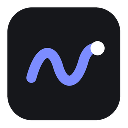

# OwnDraw



Zeichen- und Whiteboard-App mit Stift für **PC, Handy, Tablet und Browser**. Sie bietet eine unendliche Fläche oder Seiten,
Ebenen, Formerkennung, Lasso-Auswahl, Export als PNG, PDF, Website und Xournal++. In der Web-Version gibt es
zusätzlich Konten, Lizenzen und **Live-Zusammenarbeit**. OwnDraw ist komplett in Rust geschrieben (egui/eframe), mit einer Oberfläche für alle Plattformen.

| Variante | Plattform | Bezug |
| --- | --- | --- |
| Desktop | Linux (AppImage); Windows/macOS aus dem Quellcode | `./build-appimage.sh` bzw. [Releases](https://github.com/crafttixlp/ownDraw/releases) (sobald veröffentlicht) |
| Android | ab Android 8 | APK aus der CI bzw. `crates/owndraw-android/build-apk.sh` |
| Web | jeder aktuelle Browser, eigener Server | [Server installieren](#web-version-auf-dem-eigenen-server) |

## Funktionen

- **Zeichnen:** Stift mit Druck, Marker, Teil-Radierer, Formen und Formerkennung (Linie, Pfeil mit 15° nach DIN ISO 128,
  Ellipse, Polygon, Stern, Herz …), Text am Ort, Notizen, Bilder. Einrasten von Winkeln und Griffen ist einstellbar und
  lässt sich per Taste kurz aussetzen.
- **Fläche:** unendliches Whiteboard oder Seiten (A4/A5/Letter; blanko, liniert, kariert, punktiert) mit Seitenleiste.
- **Ordnen:** Ebenen, Lasso-Auswahl, Kopieren und Einfügen auch mit anderen Programmen, Drag & Drop, Rückgängig.
- **Dateien:** Ein Board ist eine Datei (`.owndraw`, ZIP mit Bildern und Vorschau), Autosave immer an. Xournal++ (`.xopp`) kann
  geöffnet und exportiert werden, dazu Export als PNG, PDF (eine Seite je Board-Seite) und Website-ZIP.
- **Oberfläche:** passt sich an Handy, Tablet und PC an. Leisten lassen sich verschieben und am Rand andocken, mit Hell/Dunkel,
  Akzentfarbe, UI-Größe 75–200 % und Werkzeuge zum Umordnen und Ausblenden.
- **Updates** (Desktop) nur auf Klick, signiert mit minisign. Zurückspringen auf ältere Versionen ist möglich.

## Web-Version

OwnDraw läuft als WebAssembly im Browser. Was man darf, hängt vom Konto ab:

| Rolle | Darf |
| --- | --- |
| Gast (ohne Konto) | voller Editor, Speichern nur als Download (`.owndraw`, PNG, PDF …) |
| Konto ohne Lizenz | wie Gast, dazu Mitarbeit an Boards, zu denen man eingeladen ist |
| Konto mit Lizenz | Boards am Server speichern (auf allen Geräten), teilen, Live-Zusammenarbeit starten |
| Admin | Admin-Panel `/admin`: Nutzer, Lizenzcodes (Laufzeit und Speicher einstellbar), Server-Updates |

Bei der Live-Zusammenarbeit sehen alle Änderungen sofort, dazu die Zeiger der anderen mit Namen. Nur der Besitzer des Boards braucht
eine Lizenz. Server-Updates kommen aus den GitHub-Releases, mit Signaturprüfung und Backup. Auf Knopfdruck oder automatisch
(standardmäßig aus).

### Web-Version auf dem eigenen Server

Voraussetzungen: Linux-Server (empfohlen Debian 12 oder Ubuntu 24.04; Fedora/RHEL, openSUSE, Alpine und Arch werden auch unterstützt), mind. 1 vCPU / 1 GB RAM (empfohlen 2 vCPU / 2–4 GB), Ports 80 und 443
offen, DNS-Eintrag (`A`, ggf. `AAAA`) der Domain auf den Server.

```sh
curl -fsSLO https://raw.githubusercontent.com/crafttixlp/ownDraw/main/packaging/server/install.sh
sudo sh install.sh
```

Der Installer fragt Domain, Admin-E-Mail und Passwort ab. Er installiert alle nötigen Pakete selbst ohne Rückfragen (git, curl, unzip, CA-Zertifikate, Docker mit Compose-Plugin …), holt das Repo nach `/opt/owndraw` und startet
den Server mit Caddy (automatisches HTTPS). Liegt eine fertige `OwnDraw-Web-<version>-statisch.zip` im selben Ordner, wird
sie verwendet. Sonst baut er die Web-App selbst. Erneut ausführen aktualisiert, Daten bleiben erhalten.
Danach: `https://<domain>/admin` öffnen, anmelden, Lizenzcodes erzeugen.

Alle Details (manuelle Installation, Backup, Updates, Konfiguration) stehen in [`docs/server.md`](docs/server.md).
Nur die Web-App ohne Server (reiner Gastmodus) läuft auf jedem statischen Webspace, siehe [`docs/web.md`](docs/web.md).

## Bedienung am PC

- Linke Maustaste zeichnet. Rechte oder mittlere Taste oder Leertaste + Ziehen verschiebt, das Mausrad zoomt.
- Tasten: P Stift, M Marker, E Radierer, S Auswahl, R Form, T Text, 0 alles zeigen, +/− Zoom,
  Strg+Z/Y/C/X/V/D, Entf löscht die Auswahl. Tooltips zeigen die Kürzel.
- Mittlere Maustaste kurz auf ein Objekt: Objekt auswählen, die Auswahlleiste erscheint.
- Text: aufs Blatt tippen und direkt schreiben (Enter = neue Zeile). Esc, Strg+Enter oder Tippen daneben übernimmt.

## Bauen

Voraussetzung: Rust ≥ 1.85.

```sh
cargo run --release                   # Desktop starten
cargo test                            # Tests (Kern, App, Server)
./build-appimage.sh                   # Linux-AppImage (gcc, zlib1g-dev, squashfs-tools)
crates/owndraw-android/build-apk.sh   # APK (Android SDK + NDK, siehe docs/android.md)
./build-web.sh                        # Web-App nach dist/web/ (wasm32 + wasm-bindgen-cli, siehe docs/web.md)
cargo run -p owndraw-server           # Server lokal (OWNDRAW_WEB=dist/web, siehe docs/server.md)
```

Die GitHub-Actions-CI baut bei jedem Push Tests, AppImage und APK (Artefakte).
Laufzeit Linux: glibc ≥ 2.39, X11 oder Wayland, OpenGL. Eine Datei als Argument wird geöffnet.

## Aufbau

| Ordner | Inhalt |
| --- | --- |
| `crates/owndraw-core/` | Kern ohne Oberfläche: Board, Seiten, Formerkennung, Rendering (tiny-skia), `.owndraw`, Xournal++, Export, Abgleich für die Zusammenarbeit |
| `crates/owndraw/` | App (egui/eframe): Oberfläche, Plattformen (Desktop, Android, Web), Autosave, Update-Dienst |
| `crates/owndraw-android/` | Android-Einstieg, Java-Hilfsklassen, Manifest |
| `crates/owndraw-web/` | Browser-Einstieg (WebAssembly) mit `index.html` |
| `crates/owndraw-server/` | Server für die Web-Version (axum + SQLite, WebSocket, Admin-Panel) |
| `packaging/` | AppImage-Vorlage, Server-Deployment (Docker, Caddy, Installer) |
| `docs/` | [Architektur](docs/architektur.md), [Web](docs/web.md), [Server](docs/server.md), [Web-API](docs/web-api.md), [Android](docs/android.md), [Release](docs/release.md) |

## Daten (Desktop)

- Boards liegen dort, wo du sie speicherst, standardmäßig in `~/Dokumente/OwnDraw/` (Android: gewählter Ordner oder App-Speicher).
- Einstellungen und Zuletzt-Liste: `~/.config/OwnDraw/`, Cache `~/.cache/OwnDraw/`.
- `OWNDRAW_DATA=<ordner>` legt alles darunter ab (Tests).

## Stand

Version 4.7.0. Desktop und Web sind automatisiert getestet (Linux, Chromium; Web auch ohne WebGL). Android, Firefox/Safari und echte
Touch-Geräte sind noch nicht auf Geräten geprüft.

Lizenz: [MIT](LICENSE)
